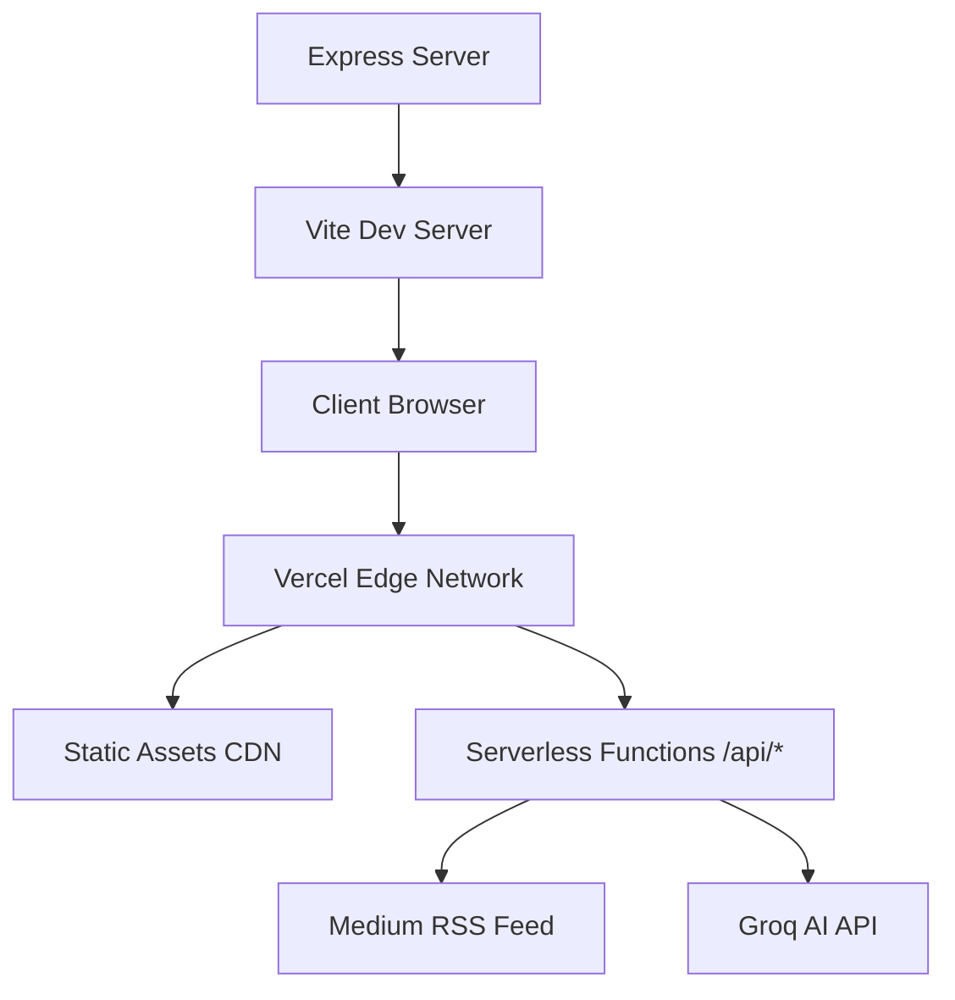

<div align="center">

# The Ink Home

[](https://theinkhome.live)
[](https://the-ink-home.vercel.app)
[](https://medium.com/the-ink-home)

*Where words feel at home — A cinematic, spatial publishing experience for independent essays.*

[Features](#-features) • [Architecture](#-architecture) • [Tech Stack](#-tech-stack) • [Getting Started](#-getting-started) • [Deployment](#-deployment) • [Security](#-security) • [Contributing](#-contributing)

</div>

---

## 🌟 Overview

The Ink Home is a production-grade, immersive web platform that transforms Medium's editorial content into a cinematic spatial reading experience. Built with modern web technologies, it features 3D interactions, dynamic theming, AI-powered assistance, and seamless integration with Medium's RSS feed.

## ✨ Features

### 🎨 Immersive Experience
- **3D Carousel** - Physics-based card carousel with drag/swipe gestures and smooth animations
- **Dynamic Atmosphere Theming** - Four distinct visual modes (Stellar, Ink, Forest, Constellation) with CSS custom properties
- **Cinematic Loader** - Elegant entrance animation with progress indication
- **Kinetic Typography** - Responsive, animated text with modern editorial design
- **Tactile Interactions** - 3D tilt effects, spring physics, and micro-animations

### 📱 User Experience
- **Multiple View Modes** - Bento grid, editorial list, and 3D carousel layouts
- **Responsive Design** - Optimized for mobile, tablet, and desktop with safe area support
- **Reading Experience** - Full-screen story modal with reading progress, share, like, and save functionality
- **Smart Caching** - Local storage for preferences, likes, and offline-first story caching
- **Accessibility First** - WCAG-compliant with skip links, ARIA labels, keyboard navigation, and reduced motion support

### 🤖 AI Integration
- **Ink Assistant** - AI-powered chatbot for submission guidelines and publication information
- **Rate Limited** - Production-grade rate limiting and input validation
- **Secure** - All AI requests proxied through serverless functions with API key protection

### ⚡ Performance
- **Code Splitting** - Automatic chunking for optimal load times
- **Lazy Loading** - Components loaded on demand
- **Optimized Assets** - Compressed fonts, images, and hashed static assets
- **Smart Caching** - Service worker-ready with intelligent cache strategies
- **Edge Ready** - Deployed on Vercel's global edge network

## 🏗 Architecture



### Deployment Modes
- **Development**: Express server (`server.ts`) with Vite middleware for hot reload
- **Production**: Vercel serverless functions (`api/`) with static SPA build

## 🛠 Tech Stack

| Category | Technologies |
|----------|-------------|
| **Frontend** | [React 19](https://react.dev/), [TypeScript](https://www.typescriptlang.org/), [Vite 6](https://vitejs.dev/) |
| **Styling** | [Tailwind CSS v4](https://tailwindcss.com/), [CSS Custom Properties](https://developer.mozilla.org/en-US/docs/Web/CSS/Using_CSS_custom_properties) |
| **Animation** | [Motion](https://motion.dev/) (Framer Motion) |
| **Backend** | [Node.js](https://nodejs.org/), [Express](https://expressjs.com/), [Vercel Functions](https://vercel.com/docs/functions) |
| **AI** | [Groq API](https://console.groq.com/) |
| **Utilities** | [DOMPurify](https://github.com/cure53/DOMPurify), [Lucide React](https://lucide.dev/), [date-fns](https://date-fns.org/) |

## 🚀 Getting Started

### Prerequisites

- Node.js >= 24.x
- npm >= 9.x
- [Groq API Key](https://console.groq.com/keys) (for AI Assistant)

### Installation

1. **Clone the repository**
   ```bash
   git clone https://github.com/farhankabir133/TheInkHome.git
   cd TheInkHome
   ```

2. **Install dependencies**
   ```bash
   npm install
   ```

3. **Configure environment variables**
   ```bash
   cp .env.example .env
   ```
   
   Edit `.env` with your credentials:
   ```env
   GROQ_API_KEY=your_groq_api_key_here
   AI_MODEL=openai/gpt-oss-20b
   ```

4. **Start development server**
   ```bash
   npm run dev
   ```
   
   The app will be available at `http://localhost:3000`

### Available Scripts

| Script | Description |
|--------|-------------|
| `npm run dev` | Start development server with hot reload |
| `npm run build` | Build for production |
| `npm run start` | Start production server locally |
| `npm run lint` | Type check with TypeScript |
| `npm run test` | Run tests with Vitest |

## 📦 Deployment

### Vercel Deployment (Recommended)

This project is optimized for Vercel deployment with zero configuration.

#### Automatic Deployment
1. Fork or clone this repository
2. Import to [Vercel](https://vercel.com/new)
3. Configure environment variables in Vercel Project Settings
4. Deploy automatically on push to `main`

#### Manual Deployment
```bash
# Install Vercel CLI
npm i -g vercel

# Login
vercel login

# Deploy to production
vercel --prod
```

### Environment Variables (Production)

Set these in your Vercel project settings under `Settings > Environment Variables`:

| Variable | Required | Description |
|----------|----------|-------------|
| `GROQ_API_KEY` | Yes | API key from [Groq Console](https://console.groq.com/) |
| `AI_MODEL` | No | AI model to use (default: `openai/gpt-oss-20b`) |
| `NODE_ENV` | Auto | Set to `production` by Vercel |

### Vercel Configuration

The project includes a production-optimized `vercel.json`:
- Serverless function configuration with appropriate timeouts
- API route rewrites
- Asset caching headers (1 year immutable)
- SPA fallback routing

## 🔒 Security

### Implemented Measures
- **API Key Protection** - All AI credentials stored server-side only
- **Input Validation** - Zod schema validation on all API endpoints
- **Rate Limiting** - Per-IP rate limiting (100 req/15min general, 10 req/min AI)
- **Security Headers** - Helmet.js with strict CSP, XSS protection, frame options
- **Content Sanitization** - DOMPurify for all user-generated HTML content
- **Secure Links** - All external links use `rel="noopener noreferrer"`
- **Error Handling** - Production-safe error boundaries without stack trace exposure
- **Request Limits** - JSON body size limits (100kb)

### Security Best Practices
- Never commit `.env` files or secrets
- Rotate API keys immediately if exposed
- Keep dependencies updated regularly
- Review security headers in production
- Monitor rate limiting and abuse patterns

## 🎯 Performance Optimizations

- **Code Splitting**: Vendor chunks for React, Motion, and UI libraries
- **Lazy Loading**: Heavy components loaded on demand
- **Asset Optimization**: Hashed filenames for long-term caching
- **Font Loading**: Self-hosted fonts with `font-display: swap`
- **Image Optimization**: Lazy loading with proper dimensions
- **Bundle Size**: Optimized with tree shaking and minification
- **Edge Caching**: Leverages Vercel's global CDN

## ♿ Accessibility

- Semantic HTML structure
- ARIA labels and roles where appropriate
- Keyboard navigation support
- Skip to main content link
- Focus visible indicators
- Reduced motion support (`prefers-reduced-motion`)
- Sufficient color contrast ratios
- Touch targets meet 44x44px minimum on mobile

## 🧪 Testing

```bash
# Run tests
npm run test

# Type checking
npm run lint
```

## 📝 Contributing

1. Create a feature branch (`git checkout -b feature/amazing-feature`)
2. Commit your changes (`git commit -m 'Add amazing feature'`)
3. Push to the branch (`git push origin feature/amazing-feature`)
4. Open a Pull Request

### Code Style
- TypeScript strict mode considerations
- ESLint/Prettier compatible
- Follow existing component patterns
- Add proper TypeScript types
- Include comments only when necessary

## 📄 License

This project is private and proprietary. All rights reserved.

## 👨‍💻 Author

**Farhan Kabir**  
[GitHub](https://github.com/farhankabir133) • [Portfolio](https://github.com/farhankabir133)

---

<div align="center">
  <sub>Built with ❤️ for The Ink Home community</sub>
</div>
